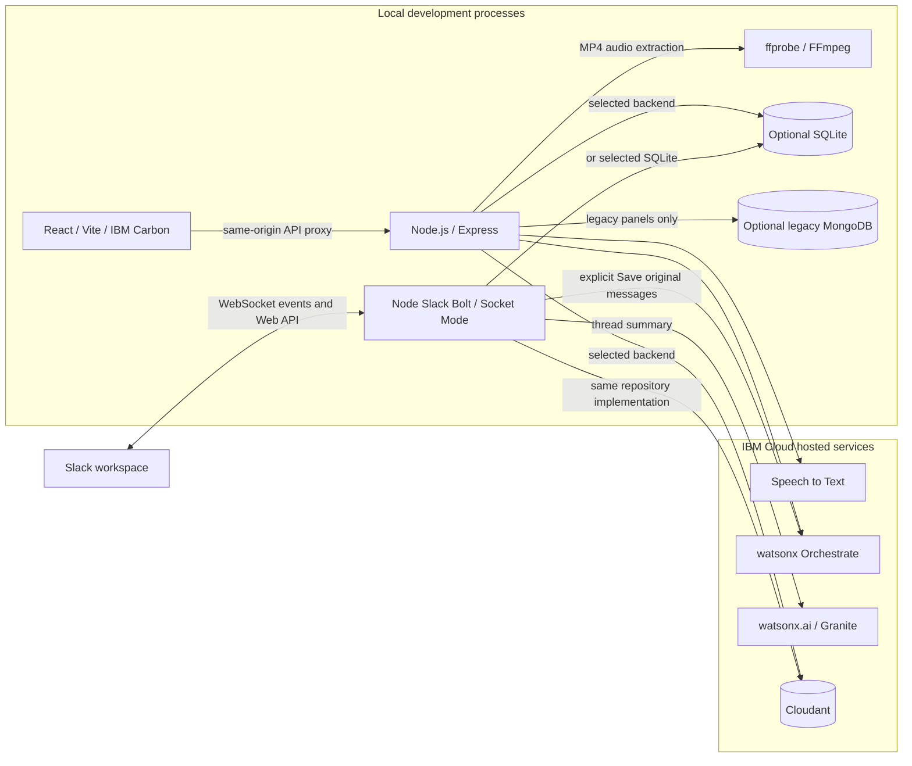

# SARDINES

SARDINES is an IBM SkillsBuild AI Sales Operations Assistant for extracting, tracking and following up on customer commitments. The working flow is:

**Meeting Notes / Buyer Email / WAV / MP4 / Slack → IBM AI → structured Promises and Actions → operational storage → human review → restricted Slack follow-up and reply tracking.**

Cloudant is the shared development store when explicitly selected. **Start onboarding with SQLite** unless the data owner has granted Cloudant access. The Dashboard can start without cloud credentials, but real analysis/transcription cannot run without their respective IBM services. HubSpot is assigned to Will and remains incomplete; production authentication is not implemented.

## Architecture



The Bolt app imports the backend extractor/repository directly; it does not need an HTTP bridge to Express, but **server dependencies must be installed**. Express and Bolt must select the same store/path to share results. WAV uses STT directly; MP4 validates streams and extracts PCM WAV first. A generated summary is never substituted for original Slack message evidence. The original MongoDB Chat/Task/Decision implementation is preserved separately.

## Prerequisites

| Tool/access | Verified requirement |
| --- | --- |
| Node.js | Use Node **24**, verified locally on **24.14.1**, including built-in node:sqlite. Slack alone declares >=22; Vite declares ^20.19.0 or >=22.12.0, but that is not full-application compatibility testing. |
| npm | Verified on **11.11.0**; no separate npm engine range is declared. Use the lockfiles with npm ci. |
| Git | Verified on **2.52.0.windows.1**; no application-specific minimum is declared. GitHub repository access is required if private. |
| FFmpeg + ffprobe | Needed only for MP4; both **9.0.2** were verified. No minimum is enforced or tested. Use trusted native binaries, not shell wrappers. |
| IBM Orchestrate | Existing authorized instance, deployed agent and matching IAM key for real text extraction. |
| IBM Cloudant | Optional: access to an existing authorized non-partitioned application database; no database is created by the app. |
| IBM STT | Optional: existing instance URL/key and supported English Multimedia model for WAV/MP4 transcription. |
| Slack + watsonx.ai | Optional: approved Slack app/tokens/scopes/Socket Mode and authorized Granite project/model. See integration setup. |
| Google Chrome | Needed for the current Playwright browser tests (`channel: chrome`); not needed for backend/API tests. |

Windows PowerShell is the verified development platform. Straightforward macOS/Linux commands are provided in [local development](docs/local-development.md), but those platforms were not tested in this batch. Use [FFmpeg's official download links](https://ffmpeg.org/download.html) for Windows build providers; do not obtain arbitrary executable downloads.

## Install and start locally — SQLite first

Run these commands in PowerShell. Do not run the clone step inside an existing working copy.

```powershell
git clone https://github.com/JPEscobari/SARDINES.git SARDINES-integration
Set-Location SARDINES-integration
git switch feature/slack-ai-summarizer
npm ci
npm ci --prefix server
npm ci --prefix client
npm ci --prefix slack-ai-summarizer
# Never overwrite existing private configuration.
if (-not (Test-Path -LiteralPath .env)) { Copy-Item -LiteralPath .env.example -Destination .env }
```

The example selects SQLite, leaves credentials empty and disables send/recovery/live-test gates. Fill only settings needed for your authorized features using the [complete 43-variable inventory](docs/environment-variables.md) and [IBM/Slack setup](docs/integration-setup.md). Do not copy credentials into VITE variables. `npm run install:all` exists but omits Slack; the four explicit install commands above cover all packages.

**Terminal 1 — backend, from repository root:**

```powershell
$env:NODE_ENV='development'
$env:OPERATIONAL_STORE='sqlite'
$env:PORT='5000'
$env:SARDINES_SLACK_SEND_ENABLED='false'
$env:SARDINES_SLACK_RECOVERY_ENABLED='false'
node server/index.js
```

**Terminal 2 — frontend, from repository root:**

```powershell
$env:API_PROXY_TARGET='http://127.0.0.1:5000'
$env:VITE_API_BASE='/api'
npm run dev --prefix client -- --host 127.0.0.1 --port 5173 --strictPort
```

Open **http://127.0.0.1:5173**. The explicit proxy avoids hostname/address-family ambiguity. Vite does **not** read root `.env` for these settings; use the frontend terminal as shown. Restart the backend/Bolt after environment changes and Vite after proxy/client settings change. `npm run server` runs Node watch mode; `npm run dev` starts backend and client via concurrently, but not Slack. Do not launch those in addition to already-running instances.

**Terminal 3 — checks (no shared writes):**

```powershell
Invoke-RestMethod http://127.0.0.1:5000/api/health
Invoke-RestMethod http://127.0.0.1:5000/api/ready
# For video only:
ffmpeg -version
ffprobe -version
```

Health reports process liveness; readiness should report `backend: sqlite`, `ready: true`, `scope: database_read`. It does not prove IBM inference, Slack or database write permission. Missing Mongo configuration is expected for the main application.

**Optional Slack terminal:** only after the app owner authorizes connecting the configured workspace, configure the tokens/project/allowlists, select the same repository settings as the backend, and run `npm start --prefix slack-ai-summarizer`. Socket Mode requires outbound WebSocket access, not a public callback tunnel. Run only one Bolt instance for this app during the demo. **Starting it connects to real Slack; using the summary shortcut sends a response, and incoming allowed replies can write to the selected repository even when follow-up sending is disabled.** See [integration setup](docs/integration-setup.md) before starting it.

## Dashboard navigation

| Page | Purpose |
| --- | --- |
| Overview | Counts from saved operational records, recent audit activity and the workflow guide |
| Analyze | Meeting Notes, Buyer Email, Audio / Voice Memo and Video Upload tabs; explicit Analyze and Save for Review |
| Promises | Searchable status-filtered Carbon table, original evidence, editable review and associated actions |
| Follow-ups | Action list/detail, explicit Promise association, owner mapping, Slack preview and reply evidence |
| Activity | Read-only stored audit timeline with links to related records |
| Integrations | Database read readiness, recipient configuration, historical verification notes and pending integrations |

Hash links support reload and browser history, for example `/#/analyze` and `/#/promises/<encoded-id>`. The original MongoDB Chat, Task Tracker and Decisions Log are preserved under **Integrations → Legacy Prototype**, outside primary navigation.

## Main workflows

1. **Meeting notes / buyer email:** open Analyze, choose the matching tab, paste original text and click Analyze. Real extraction requires the three Orchestrate settings. Inspect suggestions and exact quotes; unresolved fields are not inferred identities.
2. **WAV / MP4:** select the appropriate tab and file, click Transcribe, then edit the transcript and Analyze Transcript. Default limits are **8 MiB / 120 seconds for WAV** and **32 MiB / at most 120 seconds for MP4**. WAV must be validated 16-bit PCM; MP4 needs supported video/audio streams and installed FFmpeg/ffprobe. Video analyzes audio only. See [media details](docs/video-ingestion-handoff.md).
3. **Save and review:** click Save for Review explicitly. It writes to the selected repository; to save to Cloudant, access must be authorized and `/api/ready` must report cloudant. Find the Promise, inspect original evidence/blockers/audit and save reviewed fields. A 409 requires refresh and deliberate reapplication, never a silent overwrite.
4. **Action review:** open Follow-ups, select an Action and explicitly link the correct Promise from the same source. Review title, owner mapping and deadline. Saving a draft is not approval or external execution.
5. **Slack summary:** open a message's three-dot menu and choose the app's existing summarization shortcut. Pick the current-thread window (12/24/72 hours or 7 days), then Generate. Granite sends the summary back to the requesting Slack user. The MVP rejects threads needing pagination beyond its 15-message cap.
6. **Slack Save to SARDINES:** an allowed development user clicks Save to SARDINES on the summary. Only that click submits the original message snapshot through Orchestrate and repository validation. The offer expires after 30 minutes/restart; refresh Promises/Follow-ups to see results. Summaries are never treated as verbatim source evidence.
7. **Follow-up preview and reply:** save the Action review, choose a matching allowlisted recipient and prepare the preview. This does not send. An authorized operator handles a restricted synthetic send separately; then refresh Follow-ups to inspect sent/replied status, source message link, reply text and timestamps. A reply never completes the Promise automatically.

For a short presentation sequence, see the preserved [demo user guide](docs/demo-user-guide.md).

## Database selection

SQLite is the default and recommended onboarding store at ignored `server/data/operational.sqlite`. `SARDINES_DB_PATH` can select a separate absolute local file; keep it out of Git. No MongoDB service is needed for the operational queue.

For granted Cloudant access, set `OPERATIONAL_STORE=cloudant` plus `CLOUDANT_URL`, `CLOUDANT_API_KEY`, `CLOUDANT_DATABASE` and restart every reader/writer. Choose the **existing** database specified by its owner; the example grants no access. **Shared `sardines-dev` contains development records: never reset/delete it.** Switching stores does not migrate/merge records. Read readiness does not establish write authority. Follow the [controlled migration/backup plan](docs/cloudant-design.md) before any migration; do not copy a live SQLite main file without handling WAL safely.

## Testing

These commands do not require live cloud credentials:

```powershell
node --test server/tests/*.test.js
npm run test:api --prefix client
npm run test:browser --prefix client
npm test --prefix slack-ai-summarizer -- --runInBand
npm run build --prefix client
npm run lint --prefix client
git diff --check
```

Backend tests use temporary SQLite/local HTTP and mocked cloud transports. Client API tests are local mocks. Browser tests use installed Chrome, isolated profiles, Vite port 5194 and synthetic intercepted API/media responses. Slack tests mock Slack/IBM; log messages such as “Summary sent” refer to mocks. Build/lint are local. Do not run legacy Python `test_*.py` scripts as an offline suite: they can contact live services.

Opt-in live IBM tests, their actual commands/gates and write effects are documented in [advanced local validation](docs/local-development.md#opt-in-live-tests). Live STT/Orchestrate calls consume IBM resources; some explicitly gated tests retain new synthetic Cloudant records. None is part of automatic setup.

## Advanced restricted Slack demo — not quick start

A real DM requires separate explicit authorization for one synthetic recipient/action, current workspace/recipient allowlists, required scopes and `message.im` subscription, a saved preview, current version/hash, an interactive terminal and the existing send-enable gate. Use the [Slack operator runbook](docs/slack-live-readiness.md); **do not execute its confirmation block merely to check installation**. No executable message-send command is included in this quick start. Read-only inspection/preflight and recovery semantics are explained in [integration setup](docs/integration-setup.md#restricted-demo-and-recovery).

## Troubleshooting and limits

See [local troubleshooting](docs/local-development.md#troubleshooting) for environment precedence, stale proxies, busy ports, IAM errors, malformed STT URLs, media encoding and Slack scope/event issues. Do not delete database files or Cloudant records as a generic repair.

HubSpot is delegated to Will. Full user authentication, formal approvals, unrestricted execution, production deployment and one-hour transcription remain incomplete. Media endpoints are development-only. `NODE_ENV=production` is not a security deployment recipe. The application must not be exposed publicly against shared Cloudant without proper authentication, authorization, quotas and other controls. Existing Mongo panels remain optional; API lists are unpaginated and new replies require refresh.

[UI handoff and screenshots](docs/ui-redesign-handoff.md) · [Environment inventory](docs/environment-variables.md) · [Local setup and verification](docs/local-development.md) · [Integration setup](docs/integration-setup.md)
